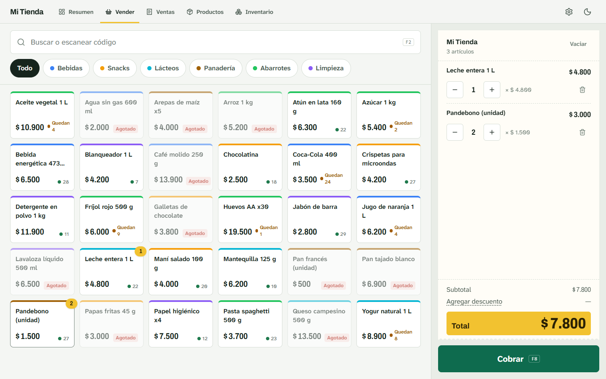
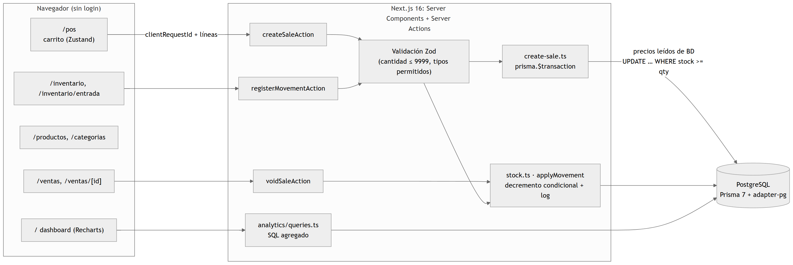

# Ventas e inventario

**[English](#english) · [Español](#español)**



**Stack:** Next.js 16 (App Router, Cache Components, Server Actions) · React 19 · TypeScript · PostgreSQL · Prisma 7 · Zod · Zustand · Recharts · Tailwind CSS 4

---

## English

Point of sale, inventory and reports for a neighborhood store, in Colombian pesos and Bogotá time. Every sale decrements stock atomically and is recorded in an inventory log.

### How it was built

I built this project with **Claude Code**, an AI coding agent. I defined what to build and gave the instructions. The agent wrote the code; I reviewed it and tested each feature by hand. It was committed as **a single commit** carrying the agent's co-author trailer, so the history doesn't show the intermediate steps. **It has no automated tests and never had real users.**

### What it does

- **Sell** (`/pos`): search or barcode scanner, cart and checkout with change. `F8` opens checkout and `Enter` charges the exact amount.
- **Sales** (`/ventas`): history with filters, cash closing, detail, voiding (returns the stock) and 80 mm receipt printing.
- **Products, categories and inventory**: purchases, adjustments, returns and the full movement log.
- **Summary** (`/`): today's sales, month profit, top sellers and products to restock.

### Key decisions



- **No overselling:** each line decrements with `UPDATE … WHERE stock >= quantity` inside the sale's transaction; if any line doesn't update, the whole sale rolls back. Lines are sorted by product so the lock order is stable and there are no deadlocks. *There is no test that proves it yet.*
- **Idempotent sales:** each checkout carries a browser-generated `clientRequestId`; a retry over a bad connection returns the existing sale instead of duplicating it.
- **Inventory log:** every stock change writes a movement with signed quantity and stock before/after, in the same transaction. Sales snapshot price and cost.
- **Money in cents (`Int`).** **Nothing is deleted:** products are archived and sales are voided.

Structure: one module per domain under `src/features/` (`sales`, `inventory`, `products`, `categories`, `analytics`, `settings`), each with queries, Server Actions, Zod schemas and services.

### Run it locally

Requires Node.js 22+ and a local PostgreSQL (tested with 18). Tested from a clean clone on Windows on 2026-11-01.

```bash
git clone https://github.com/nicho1607/ventas-inventario.git
cd ventas-inventario

psql -U postgres -c "CREATE DATABASE ventas_inventario"

cp .env.example .env   # DATABASE_URL → postgresql://postgres:<password>@localhost:5432/ventas_inventario
npm ci
npx prisma migrate deploy
npm run db:seed        # 60 days of sample sales
npm run dev            # http://localhost:3000
```

> `npm run build` needs the database created and migrated, because `/configuracion` queries it at build time.

| Command | What it does |
|---|---|
| `npm run build` / `npm start` | Production build and server (requires the DB) |
| `npm run lint` | ESLint |
| `npm run db:seed` | Wipes and reloads sample data; keeps the store settings |
| `npm run db:reset` | Drops the DB, reapplies migrations and seeds |

### Known limitations

- **No authentication or roles:** anyone with the URL can sell, void sales or adjust stock.
- **No automated tests**, including the concurrency case above.
- The build depends on the database.

---

## Español

Punto de venta, inventario y reportes para una tienda de barrio, en pesos colombianos y hora de Bogotá. Cada venta descuenta el stock de forma atómica y queda registrada en una bitácora.

### Cómo lo construí

Construí este proyecto con **Claude Code**, un agente de programación. Yo definí qué construir y le di las instrucciones. El agente escribió el código; yo lo revisé y probé cada funcionalidad a mano. Quedó en **un solo commit** con la firma de coautor del agente, así que el historial no muestra los pasos intermedios. **No tiene tests automatizados ni tuvo usuarios reales.**

### Qué hace

- **Vender** (`/pos`): búsqueda o lector de código de barras, carrito y cobro con cambio. `F8` abre el cobro y `Enter` cobra el monto exacto.
- **Ventas** (`/ventas`): historial con filtros, cierre de caja, detalle, anulación (devuelve el stock) e impresión de tirilla de 80 mm.
- **Productos, categorías e inventario**: compras, ajustes, devoluciones y la bitácora completa.
- **Resumen** (`/`): ventas del día, ganancia del mes, lo más vendido y productos por reponer.

### Decisiones importantes

- **Sin sobreventa:** cada línea descuenta con `UPDATE … WHERE stock >= cantidad` dentro de la transacción; si alguna no se actualiza, se revierte la venta completa. Las líneas se ordenan por producto para que el orden de bloqueo sea estable. *Todavía no hay un test que lo demuestre.*
- **Ventas idempotentes:** cada cobro lleva un `clientRequestId`; un reintento devuelve la venta existente en vez de duplicarla.
- **Bitácora de inventario:** todo cambio de stock crea un movimiento con el stock antes y después, en la misma transacción.
- **Dinero en centavos (`Int`).** **Nada se borra:** los productos se archivan y las ventas se anulan.

### Correrlo en local

Requiere Node.js 22+ y PostgreSQL local (probado con la 18). Los comandos son los de la sección en inglés. `npm run build` necesita la base de datos creada y migrada.

### Limitaciones conocidas

- **Sin autenticación ni roles:** cualquiera con la URL puede vender, anular ventas o ajustar stock.
- **Sin tests automatizados**, incluido el caso de concurrencia.
- El build depende de la base de datos.
